# 软件介绍与使用说明

DBGo 是网页版数据库工作台。用它保存数据库连接，浏览表和例程，编写并执行 SQL，修改查询结果里的行，设计或更新表结构，再做迁移、备份和 ETL。目标库可以是 SQLite、MySQL、PostgreSQL 或 SQL Server。应用自己的账号、会话和这些登记信息默认放在本机 SQLite 里。

每个账号只能看到自己创建的连接、查询历史、迁移、备份、ETL 任务和代码段。兼容 OpenAI 协议的模型配置是共用的，密钥只加密存在本机，接口不回传原文。

下面的界面图来自一次实际操作：登记一个可打开的 SQLite 示例库「门店示例」，以及一个打不开的「离线库」。MySQL、PostgreSQL 和 SQL Server 使用同一套页面，差别在连接参数和各数据库自己的语句。

安装、配置和发行见 [README](../README.md)、[部署](deployment.md)。接口见 [API](api.md)，内部结构见 [架构](architecture.md)。

## 打开

网页版：

```bash
go run ./cmd/server --data-dir ./data
```

浏览器打开 `http://127.0.0.1:8080`。开发环境第一次启动会在数据目录生成 `initial-admin-password.txt`，用 `admin` 和文件里的口令登录。生产环境要事先设置至少八位的 `APP_AUTH_ADMIN_PASSWORD`。

桌面版覆盖 Windows x64、macOS x64 和 arm64、Linux x64 和 arm64。Windows 在仓库里运行 `scripts\build-electron.cmd`，Linux 和 macOS 运行 `./scripts/build-electron.sh`。安装包在 `electron/dist/`。窗口只打开本机服务，数据放在系统的用户数据目录。第一次打开会提示管理员账号和初始口令。

## 登录和账号

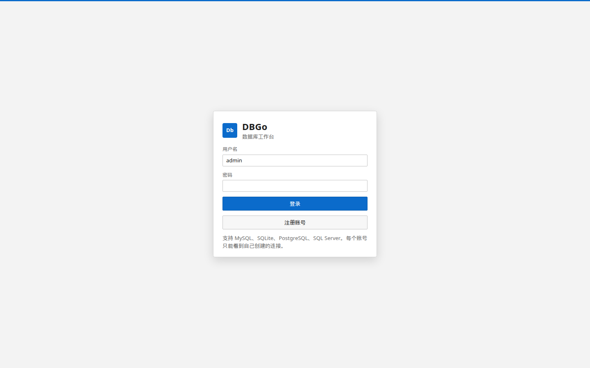

登录页可以注册成员。注册是否开放由 `auth.allow_register` 决定。右上角的用户名菜单可以进入个人中心、修改密码或退出。修改密码后当前会话失效，需要重新登录。

## 工作台

登录后进入工作台。

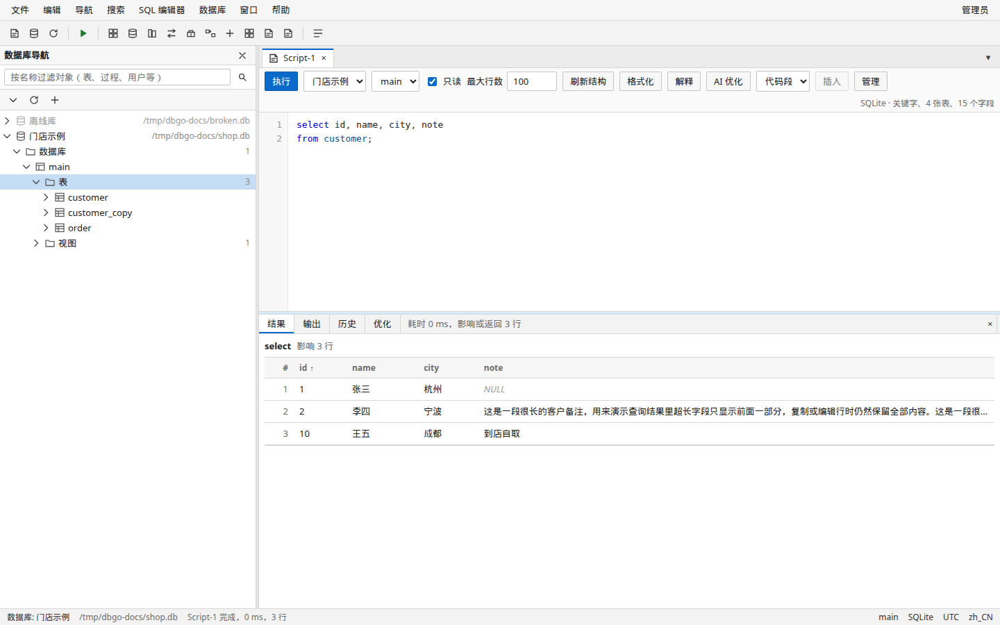

从上到下、从左到右是：

- 菜单：文件、编辑、导航、搜索、SQL 编辑器、数据库、窗口、帮助。
- 工具栏：新建脚本、新建连接、刷新导航，以及总览、连接、结构、迁移、备份、ETL、对象设计、性能、大模型、代码段。
- 左侧数据库导航。可以按名称过滤，拖动右边的分隔条调整宽度，也可以收起。
- 中间的多标签页。SQL 脚本、对象和各个工具各自占一个标签。
- SQL 编辑器和底部的结果区。结果区可以拖高，也可以从标签上的关闭按钮隐藏。
- 底部状态栏：当前数据库、本次执行摘要、模式、驱动和时区。

图中的「离线库」打不开，名称和图标是灰色的。能打开的连接保持正常颜色。连接默认不会在启动时全部打开，展开导航时才去连接。

## 连接

从工具栏或「数据库 → 连接管理」打开。

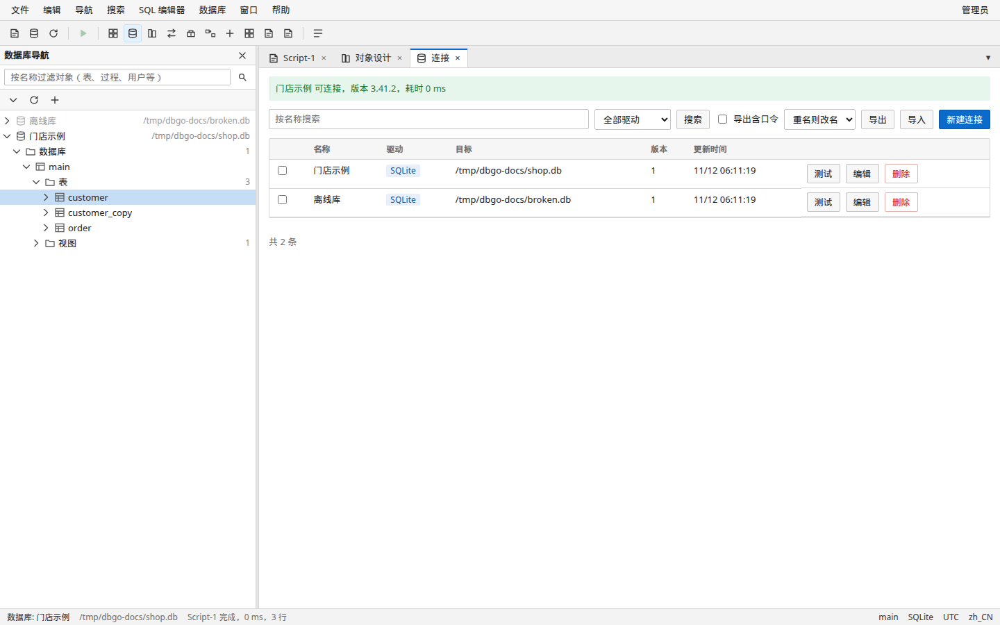

新建连接时选择驱动：

| 驱动 | 要填的内容 |
| --- | --- |
| SQLite | 数据目录内的相对路径，或本机绝对路径。不能把应用自己的库登记成业务连接 |
| MySQL、SQL Server | 主机、端口、数据库名、用户名、口令 |
| PostgreSQL | 同上，另外可以选择 SSL 模式 |

保存后点「测试」，页面会显示服务器版本和耗时。列表里的「版本」是这条连接记录自己的版本号，用来避免两个人同时改同一条记录时互相覆盖。

导出默认不写口令。勾选「导出含口令」时，文件里会带出口令，只应交给需要它的人。导入可以按重名改名、跳过或报错。删除连接会保留已经产生的查询历史和备份记录。

一条连接能列出多个数据库时，展开导航后会看到这些库。编辑器里的「默认模式」就是这次执行使用的库，状态栏也会显示它。

## 浏览对象

在导航里逐级展开连接、数据库、表、视图、列和索引。SQLite 没有存储过程和函数，另外三种数据库可以展开例程。双击表会打开只读查询，双击例程会打开定义。

在表上右键：

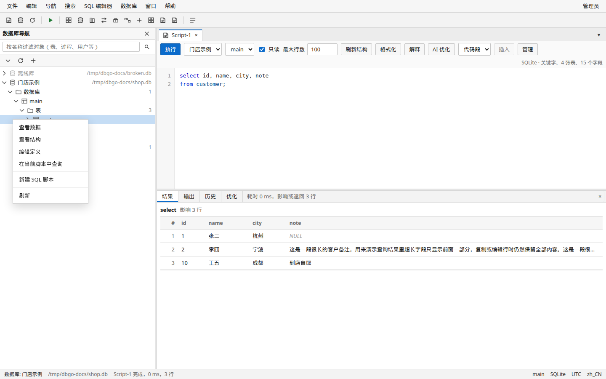

可以查看数据、查看结构、编辑定义，或把 `select` 放进当前脚本。在连接上右键可以测试、打开性能、迁移、备份、ETL，或编辑和删除这条连接。

「结构」页把同一张表的字段和索引用表格列出来。

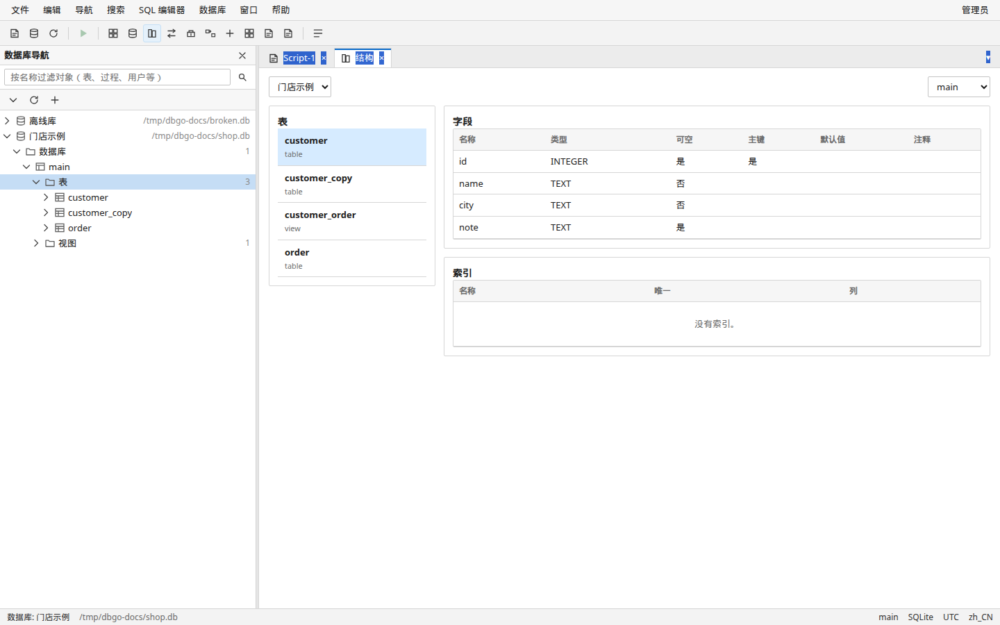

## 编写和执行 SQL

在脚本标签里选择连接和默认模式。默认勾着「只读」，查询可以执行，写入要先取消只读。最大行数默认 100，上限 1000，超出的结果会标成已截断。

常用操作：

- 「执行」，或 Ctrl / ⌘ + Enter。选中一段再从编辑器右键执行时，只跑选中的语句。
- 「格式化」「解释」。解释会在语句前加上当前数据库的执行计划语句。
- Ctrl + Space 提示关键字、表和字段。提示跟当前连接和模式走。
- 「代码段」下拉框可以把已保存的语句插到光标处。

一次可以写多条语句。某一条失败时，结果区和状态栏会写出出错的行，编辑器左侧对应的行号会标出来。

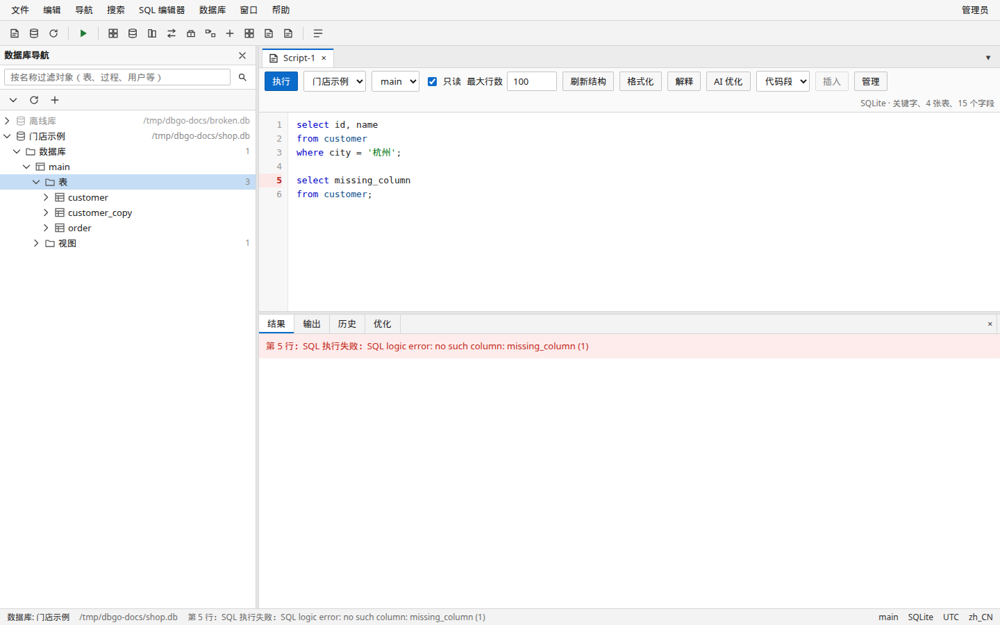

SQL Server 的 `PRINT` 等消息出现在结果区的「输出」页。执行过的语句在「历史」里，点一条可以放回编辑器。

### 结果排序和长字段

点结果表的列名，按这个顺序切换：升序、降序、恢复查询返回的顺序。空值在升序和降序里都排在最后。整数和小数按原来的数字文本比较，很长的 BIGINT 或小数不会先被收成普通浮点数。

超过显示长度的单元格只画出前面一段，并在末尾加省略号。选中这种单元格再复制，剪贴板里是完整内容。右键菜单也可以复制。

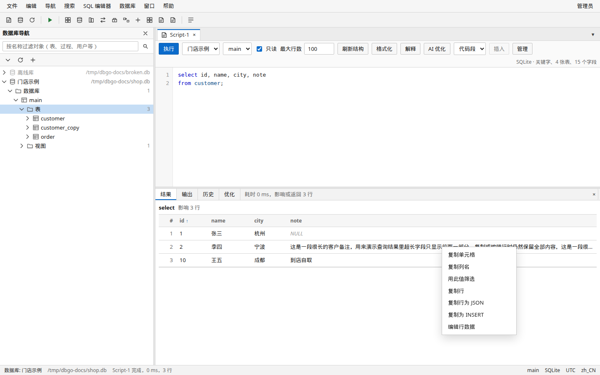

菜单里可以复制单元格、列名、整行、JSON 或 `INSERT`，也可以用当前值改写一条筛选语句。

### 编辑行

单表查询的结果可以右键「编辑行数据」。主键或唯一索引用来定位这一行；没有可用的键时，保存前会说明可能一次更新多行。

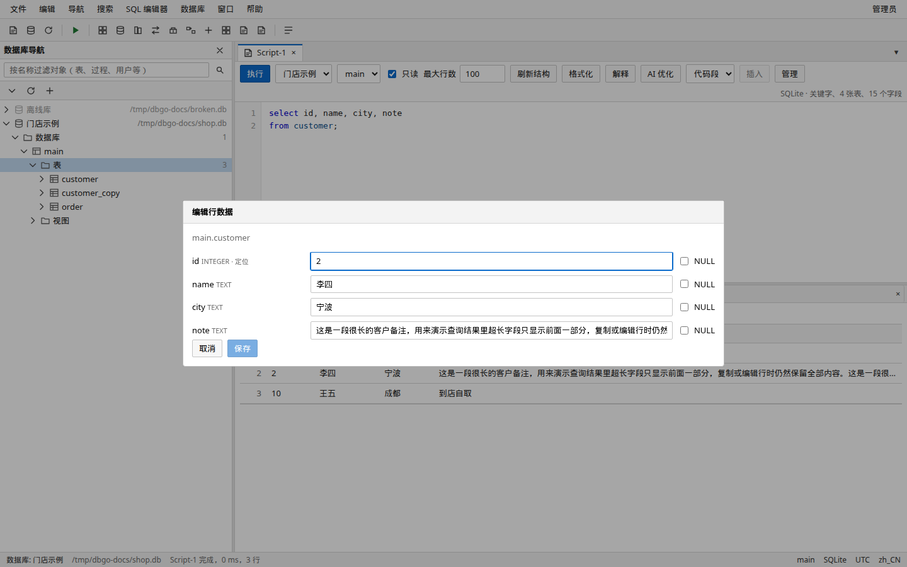

对话框里是完整的字段值，表格里仍然是省略后的预览。保存会向目标库执行更新。这个写入不受脚本上的「只读」勾选限制，保存前要看清改的是哪一张表。

### 标签

在标签上右键，可以关闭当前、关闭其他、关闭全部、关闭左边或关闭右边。

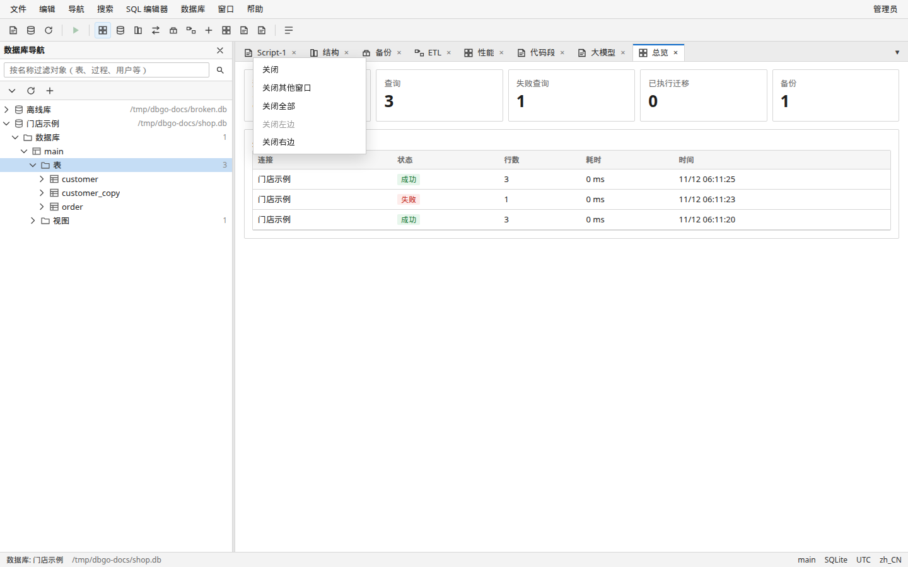

标签和编辑器里的语句会记在本机浏览器里，刷新页面后还在。

## 设计对象和更新表结构

「数据库」菜单或工具栏可以新建表、视图、存储过程或函数。列类型按当前连接的数据库给出选项。SQLite 不能在这里创建存储过程或函数。

编辑已有表时，先「读取定义」。字段改完后点「更新结构」，页面先弹出生成的语句，确定后才执行，取消则不改表。

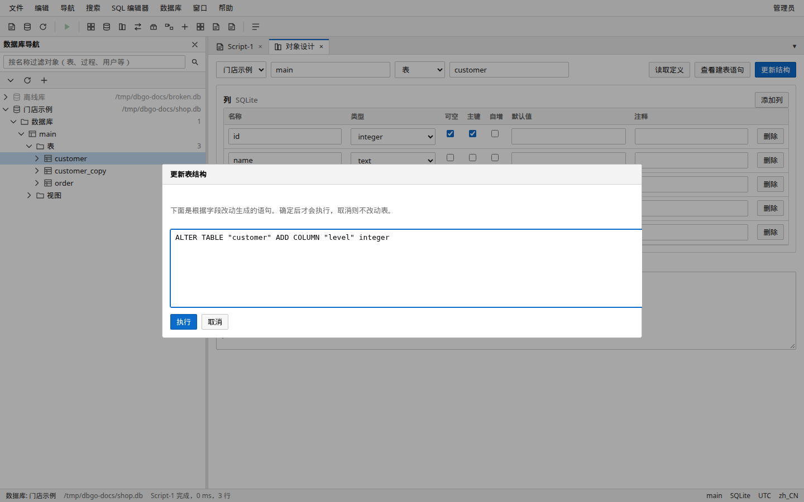

新建对象时，先「生成 SQL」，可以改完再执行。表的「替换已有对象」会先删除同名表。

## 代码段

代码段是当前账号自己的 SQL 片段，可以按名称搜索，插入到正在编辑的脚本，也可以用 JSON 导入或导出。

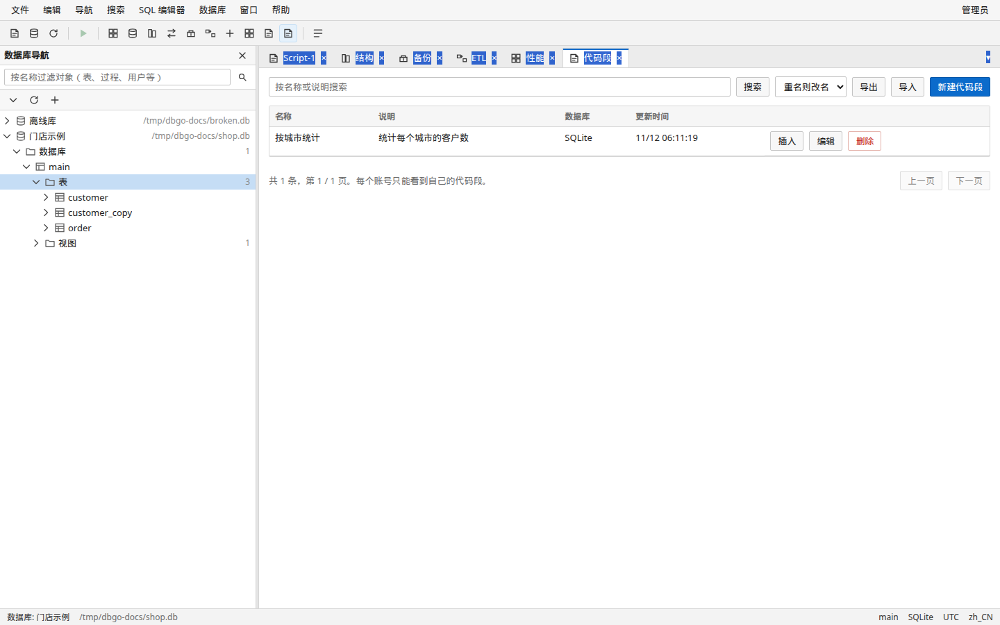

数据库一项留空表示不限驱动，也可以指定只用于某一种数据库。

## 性能

选择连接和模式后点「采集」。页面显示库大小、会话和对象规模。SQLite 没有独立的会话列表，页面会直接说明。

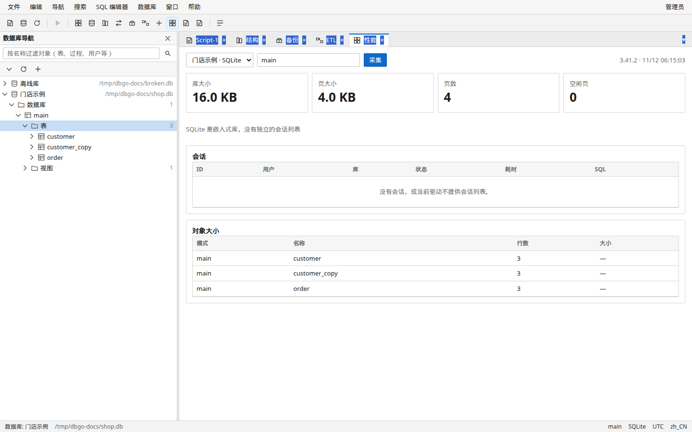

## 迁移

迁移按连接保存。新建时填写版本号、名称、升级 SQL 和回滚 SQL。

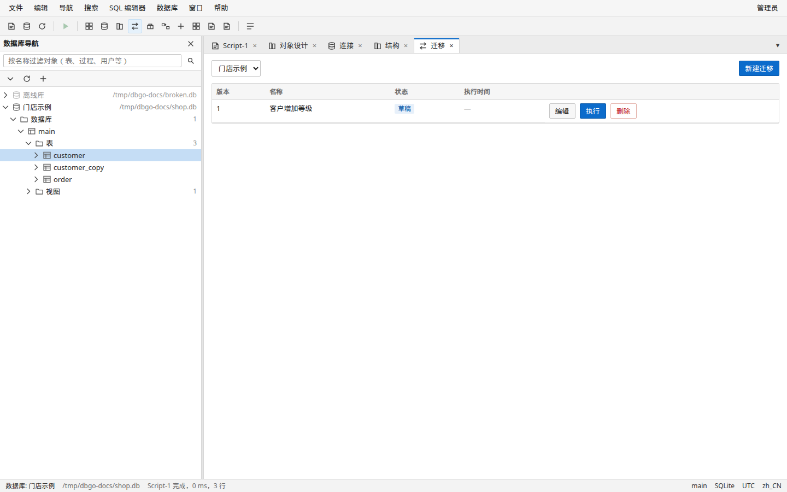

草稿可以编辑、执行或删除。执行成功后可以回滚。执行过程中如果目标库已经跑完、状态没写上，记录会停在「执行中」或「回滚中」，这时用「中止」或「确认」收口。失败的脚本保持失败，改完可以再执行。

## 备份

选择连接，填写名称，再选格式。

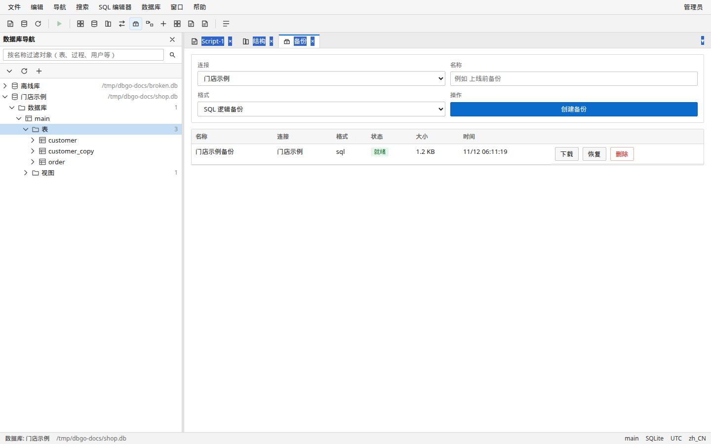

- SQL 逻辑备份可以下载，也可以恢复。恢复会把备份里的语句再执行一遍，恢复前要确认目标库可以被这些 `CREATE` 和 `INSERT` 覆盖。
- SQLite 还可以做文件副本。副本只供下载，不能在页面里恢复。

备份成功只说明文件写完。

## ETL

ETL 用一条查询从源连接抽取数据，按字段对应写到目标连接的一张表。转换写在抽取语句里。

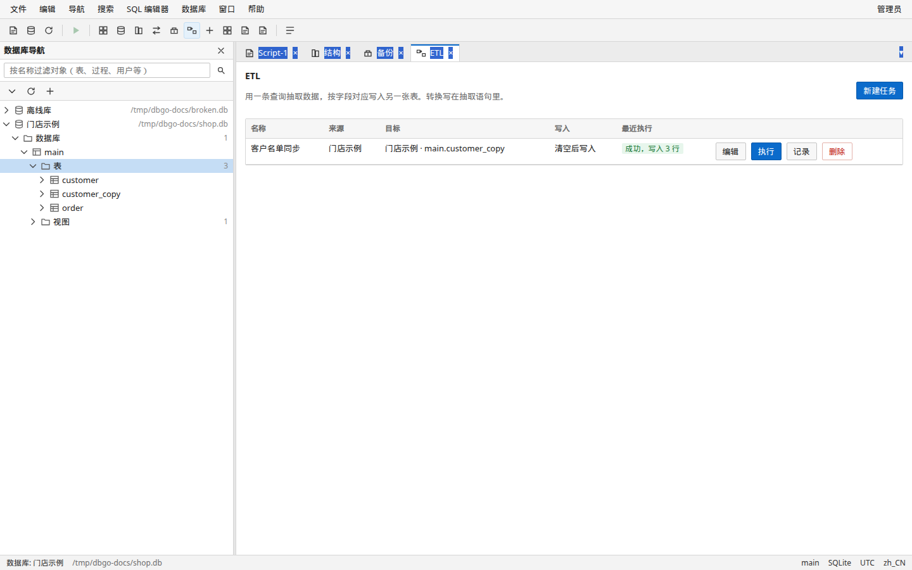

写入方式有两种：追加，或清空目标表后再写入。执行中可以中止。记录里能看到每次读了多少行、写了多少行。删除任务会一起删除执行记录，目标表里的数据保留。

## 大模型

SQL 编辑器里的「AI 优化」需要先配置一个兼容 OpenAI 协议的服务。地址填到 `/v1`。

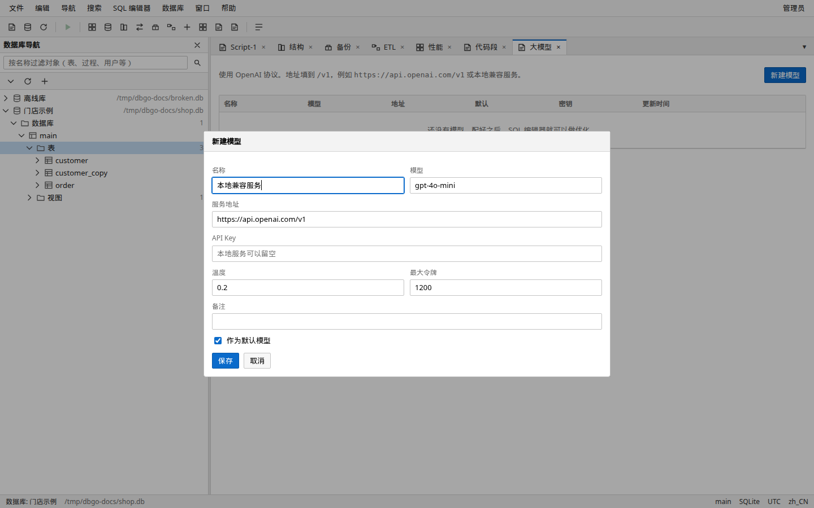

可以指定模型名、温度和最大令牌，并指定哪一个是默认模型。本地兼容服务可以不填密钥。配好之后，在编辑器里点「AI 优化」，建议出现在结果区的「优化」页，确认后可以替换进编辑器。

## 总览

总览汇总当前账号的连接、查询、失败查询、已执行迁移和备份，并列出最近的查询。

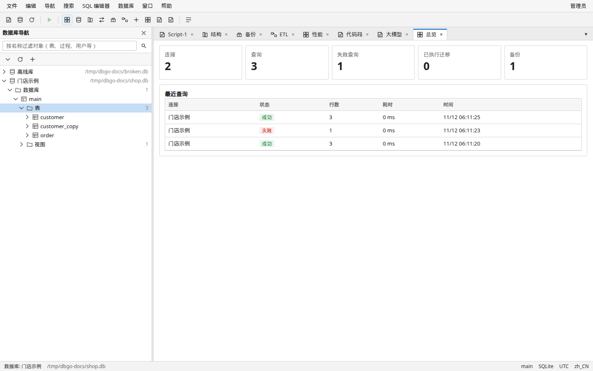
